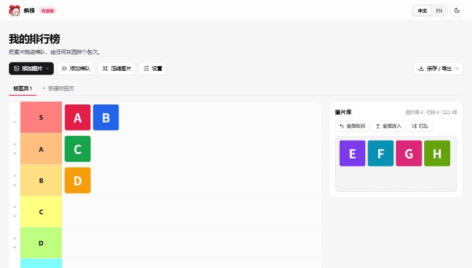

<p align="center">
  
</p>

<h1 align="center">飙榜双语版 · Biaobang Bilingual</h1>

<p align="center">
  完全离线的 Tier List 排行榜制作工具，一键切换中文 / English。<br/>
  A fully offline tier list maker with a one-click Chinese / English switch.
</p>




## 我们的改进 · What we changed

本项目基于 [milk3e/Tier-List-Maker](https://github.com/milk3e/Tier-List-Maker)，在保留全部原有排行功能的基础上做了这些改进：
This project is based on [milk3e/Tier-List-Maker](https://github.com/milk3e/Tier-List-Maker). It keeps every original ranking feature and adds the following:

| | 原版 Upstream | 飙榜双语版 Biaobang Bilingual |
|---|---|---|
| 界面语言 Language | 仅英文 English only | **中文 / English 一键切换**，所有按钮、弹窗、提示都会切换，并记住你的选择 · one-click switch covering every button, dialog and message; your choice is remembered |
| 界面设计 Design | 基础深色样式 + emoji 按钮 · basic dark style with emoji buttons | **重新设计**：顶栏、卡片布局、矢量线条图标、重做的弹窗和提示 · **redesigned** with an app bar, card layout, vector line icons, and new dialogs and toasts |
| 主题 Theme | 只有深色 · dark only | **浅色 / 深色**，默认跟随系统，可手动切换 · **light and dark**, follows the system by default, switchable |
| 保存 Saving | 导出 / 导入 JSON 文件 · export and import JSON files | **一键「保存设置」**：梯队名称（如「夯 → 拉」）、颜色、顺序、标签页、榜单标题，下次打开自动恢复；不再需要处理 JSON 文件 · **one-click "Save Settings"** for tier names (e.g. a custom set like 夯 → 拉), colors, order, tabs and the title, restored on the next launch; no JSON files to manage |
| 工具栏 Toolbar | 「Save/Load」下拉菜单 · Save/Load dropdown | 两个按钮：**保存设置**、**导出图片** · two buttons: **Save Settings** and **Export Image** |
| 品牌与图标 Branding | 无图标 · no icon | 专属头像图标：网页图标、应用图标、Windows `.ico` · its own avatar icon set: favicon, app icons and a Windows `.ico` |
| 安装 Install | 手动打开 HTML 文件 · open the HTML file by hand | **`install.ps1` 一键安装**，生成桌面快捷方式，以应用窗口打开 · **one-step `install.ps1`** that creates a Desktop shortcut and opens in an app window |

仍然是**单个 HTML 文件、完全离线、不联网、不上传任何图片**。
It is still **a single HTML file that works fully offline, makes no network calls and never uploads images**.

## 中文

### 功能
- **中 / EN 一键切换**：右上角切换界面语言，选择会被记住。
- **浅色 / 深色主题**：默认跟随系统，也可以手动切换。
- 梯队可以新增、删除、改名、改颜色、上下移动。
- 图片支持选择文件、拖拽、`Ctrl+V` 粘贴、图片链接，支持 GIF 动图。
- 图片可在梯队之间拖动排序，支持正方形裁切 / 保持比例、压缩、改名、添加描述。
- 多标签页：同一批图片可以做多份排行。
- **保存设置**：梯队名称、颜色、顺序、标签页和榜单标题点一下「保存设置」就会记住，下次打开自动恢复（图片不保存）。
- 导出 PNG / JPEG 图片（最高 24 倍分辨率）。
- 单个 `index.html`，没有任何外部依赖，也不联网。

### 使用
- **直接用**：双击 `index.html`，在浏览器中打开。
- **安装到桌面（Windows）**：运行 `install.ps1`，会把程序装到 `%LOCALAPPDATA%\Programs\Biaobang`，并在桌面创建「飙榜双语版」快捷方式（用 Edge / Chrome 的应用窗口模式打开）。

```powershell
powershell -ExecutionPolicy Bypass -File install.ps1
```

## English

### Features
- **中 / EN toggle** in the top-right corner; your choice is remembered.
- **Light / dark theme** that follows the system by default.
- Tiers you can add, delete, rename, recolor, and reorder.
- Add images from files, drag & drop, `Ctrl+V`, or a URL. GIFs stay animated.
- Drag to sort images across tiers. Crop to square or keep the aspect ratio, compress, rename, and add descriptions.
- Multiple tabs, so one image set can have several rankings.
- **Save Settings** remembers tier names, colors, order, tabs and the title, and restores them next time (images are not saved).
- Export as PNG / JPEG (up to 24×).
- A single `index.html` with no external dependencies and no network calls.

### Usage
- **Open directly:** double-click `index.html`.
- **Install on Windows:** run `install.ps1`. It copies the app to `%LOCALAPPDATA%\Programs\Biaobang` and creates a "飙榜双语版" desktop shortcut that opens in an Edge/Chrome app window.

## 隐私 · Privacy
所有图片和数据都只在你的浏览器里。语言、主题和「保存设置」的内容存在浏览器的 `localStorage` 里，图片不会被保存。
Everything stays in your browser. Language, theme and saved settings live in `localStorage`; images are not stored.

## 致谢 · Credits
基于 [milk3e/Tier-List-Maker](https://github.com/milk3e/Tier-List-Maker)（CC0 公有领域）。本版本增加了中英双语、新的界面设计、主题切换、应用图标和 Windows 安装脚本。
Based on [milk3e/Tier-List-Maker](https://github.com/milk3e/Tier-List-Maker) (CC0 public domain). This version adds the bilingual UI, the redesign, theme switching, app icons, and the Windows installer.

本项目同样以 [CC0](LICENSE) 发布。Released under [CC0](LICENSE) as well.
