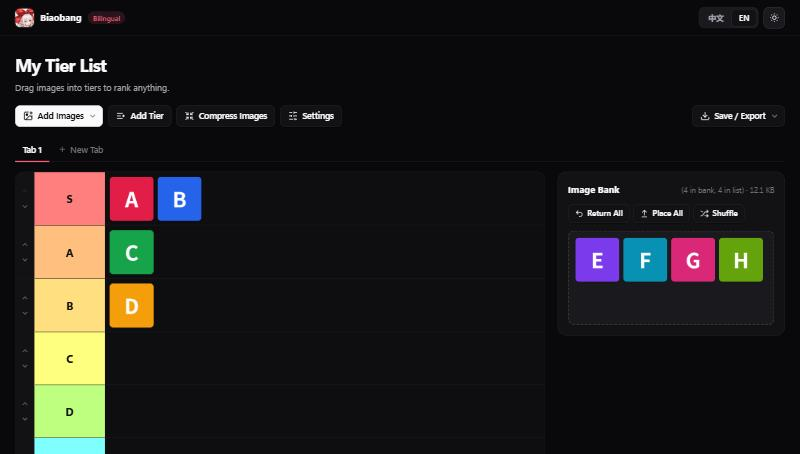

<p align="center">
  
</p>

<h1 align="center">飙榜双语版 · Biaobang Bilingual</h1>

<p align="center">
  完全离线的 Tier List 排行榜制作工具，一键切换中文 / English。<br/>
  A fully offline tier list maker with a one-click Chinese / English switch.
</p>




## 中文

### 功能
- **中 / EN 一键切换**：右上角切换界面语言，选择会被记住。
- **浅色 / 深色主题**：默认跟随系统，也可以手动切换。
- 梯队可以新增、删除、改名、改颜色、上下移动。
- 图片支持选择文件、拖拽、`Ctrl+V` 粘贴、图片链接，支持 GIF 动图。
- 图片可在梯队之间拖动排序，支持正方形裁切 / 保持比例、压缩、改名、添加描述。
- 多标签页：同一批图片可以做多份排行。
- 导出 PNG / JPEG 图片（最高 24 倍分辨率），以及 JSON 存档的导出 / 导入。
- 单个 `index.html`，没有任何外部依赖，也不联网。

### 使用
- **直接用**：双击 `index.html`，在浏览器中打开。
- **安装到桌面（Windows）**：运行 `install.ps1`，会把程序装到 `%LOCALAPPDATA%\Programs\Biaobang`，并在桌面创建「飙榜双语版」快捷方式（用 Edge / Chrome 的应用窗口模式打开）。

```powershell
powershell -ExecutionPolicy Bypass -File install.ps1
```

## English

### Features
- **中 / EN toggle** in the top-right corner; your choice is remembered.
- **Light / dark theme** that follows the system by default.
- Tiers you can add, delete, rename, recolor, and reorder.
- Add images from files, drag & drop, `Ctrl+V`, or a URL. GIFs stay animated.
- Drag to sort images across tiers. Crop to square or keep the aspect ratio, compress, rename, and add descriptions.
- Multiple tabs, so one image set can have several rankings.
- Export as PNG / JPEG (up to 24×) and save or load JSON files.
- A single `index.html` with no external dependencies and no network calls.

### Usage
- **Open directly:** double-click `index.html`.
- **Install on Windows:** run `install.ps1`. It copies the app to `%LOCALAPPDATA%\Programs\Biaobang` and creates a "飙榜双语版" desktop shortcut that opens in an Edge/Chrome app window.

## 隐私 · Privacy
所有图片和数据都只在你的浏览器里。只有语言和主题偏好会存进 `localStorage`，排行榜内容需要你自己导出 JSON 保存。
Everything stays in your browser. Only the language and theme preferences go to `localStorage`. To keep a tier list, export it as JSON.

## 致谢 · Credits
基于 [milk3e/Tier-List-Maker](https://github.com/milk3e/Tier-List-Maker)（CC0 公有领域）。本版本增加了中英双语、新的界面设计、主题切换、应用图标和 Windows 安装脚本。
Based on [milk3e/Tier-List-Maker](https://github.com/milk3e/Tier-List-Maker) (CC0 public domain). This version adds the bilingual UI, the redesign, theme switching, app icons, and the Windows installer.

本项目同样以 [CC0](LICENSE) 发布。Released under [CC0](LICENSE) as well.
